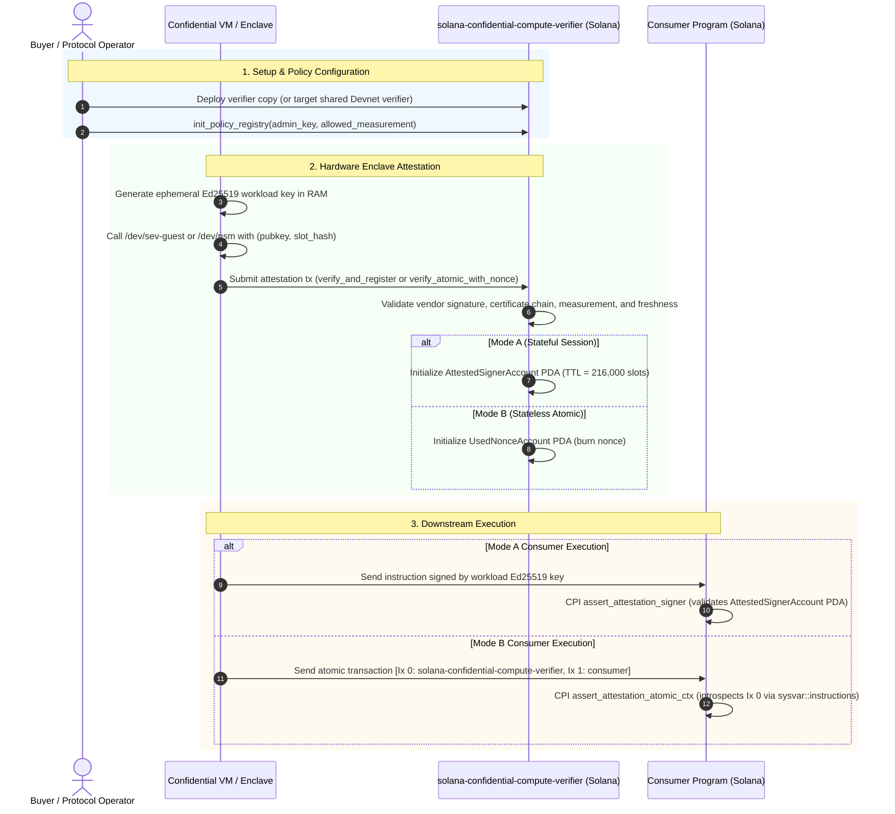

# Grant handoff guide

Solana Confidential Compute for the Solana Foundation. This guide shows what shipped, how to repeat the hardware checks, which Devnet transactions exist, and how the buyer deploys a separate copy.

Release `v1.0.0` is git tag `v1.0.0`.

The root [README.md](../../README.md) is the repository documentation. This guide is the walkthrough. `@spec GRANT-M4-001` names the closeout narrative in [../milestones/grant-closeout-dossier.md](../milestones/grant-closeout-dossier.md). All technical measurements, ELF sizes (673,784-byte verifier, 127,744-byte consumer), deployment slots, and commands are 100% harmonized between this guide and the closeout dossier. 4,552 bytes is the NSM wire response payload. 4,526 bytes is the embedded COSE document at offset 26.

`@spec SCC-ARCH-001` `@spec SCC-VERIFY-001` `@spec SCC-SEC-001` `@spec GRANT-M4-001`

---

## 1. What you can do after this grant

An operator key on a server can sign a Solana transaction. If that server is copied, the key is copied. Solana Confidential Compute moves the workload key into an encrypted virtual machine. The CPU signs a report that names the key and a fresh Solana slot. The on-chain program checks that report. A consumer program then accepts only that key.

```
 +---------------------------+
 | Confidential VM           |
 | AMD SEV-SNP  or  Nitro    |
 | Ed25519 key stays in RAM  |
 +-------------+-------------+
               | signed report
               v
 +---------------------------+
 | solana-confidential-compute-verifier            |
 | EKfHCTnsbRQfURsdmzkmuoxUx7DVt8WsQ5X7t49ZZZh
 | checks the vendor signature
 | checks the measurement
 | checks the slot is fresh
 +-------------+-------------+
               |
       +-------+--------+
       |                |
       v                v
   Mode A            Mode B
   154-byte PDA      previous instruction
   later txs use     in the same transaction
   Ed25519 only
       |                |
       v                v
 +---------------------------+
 | solana-confidential-compute-consumer-reference  |
 | A5cSGHXvQmAejZSVu3D1HwMuaVBJnrt2khz7GVy4cUZZ
 +---------------------------+
```

### Buyer Lifecycle Sequence

The sequence below illustrates the complete integrator journey from initial policy deployment to verified instruction execution:



Two hardware roots are in the tree:

- AMD SEV-SNP on a Google Cloud confidential VM, through `/dev/sev-guest`.
- AWS Nitro Enclaves, through `/dev/nsm`, with the probe sending the document over `AF_VSOCK`.

Google Cloud OIDC for a confidential-space image is a third path. The on-chain instruction is `verify_google_jwt`.

---

## 2. Milestone scorecard

The four gate records mark Gates 1 through 4 satisfied. The closeout dossier in [../milestones/grant-closeout-dossier.md](../milestones/grant-closeout-dossier.md) marks the delivery 100 percent complete on that basis.

| Gate | What the record requires | Record | Status in the record |
| :--- | :--- | :--- | :--- |
| Gate 1 | The CLI reads an SEV-SNP report, or a mock report, and checks the signature on the host. | [../milestones/gate-1-verification.md](../milestones/gate-1-verification.md) | Satisfied |
| Gate 2 | The verifier runs Mode A and Mode B in the test environment. | [../milestones/gate-2-verification.md](../milestones/gate-2-verification.md) | Satisfied |
| Gate 3 | A publisher, the verifier, and the reference consumer run on Devnet. | [../milestones/gate-3-verification.md](../milestones/gate-3-verification.md) | Satisfied |
| Gate 4 | A Nitro enclave document is captured. The SBPFv3 program is on Devnet. The docs pack exists. | [../milestones/gate-4-verification.md](../milestones/gate-4-verification.md) | Satisfied |

```
 Gate 1          Gate 2           Gate 3          Gate 4
 host prove  --> on-chain tests -> Devnet deploy -> Nitro + SBPFv3
 SATISFIED       SATISFIED        SATISFIED       SATISFIED
```

Read section 7 before you treat a Devnet log line as a successful hardware verification. The upgrade transaction landed. The cited Nitro smoke transaction failed closed. The cryptographic checks of the committed fixtures pass on any machine.

Contract baseline in the roadmap: four months, nine components. That table is the grant scope. This guide does not restate the dollar lines.

---

## 3. Addresses

| Piece | Value |
| :--- | :--- |
| Release | tag `v1.0.0` |
| Verifier | `EKfHCTnsbRQfURsdmzkmuoxUx7DVt8WsQ5X7t49ZZZh` |
| Verifier ELF | SBPFv3, `e_flags = 0x3`, 673,784 bytes, slot 505,980,419 |
| Reference consumer | `A5cSGHXvQmAejZSVu3D1HwMuaVBJnrt2khz7GVy4cUZZ` |
| Consumer ELF | `e_machine = 0x107`, `e_flags = 0x0`, 127,744 bytes, slot 505,980,264 |
| Policy registry PDA | `2FX8HZqEXr7x8kHzkhy4KPUuViVt9M6xqhFTB12jaDUf` |
| Upgrade authority | `BNiGJpc6zkmkk7Jir1ggRfyxFy2fwjMmt2BUDUEg4eCG` |
| Program data account | `EWShgrBQhkQiTmGTrYm9DuWvUPKRcsbECqXJuGa1BFcX` |
| Cluster | Solana Devnet |
| Runtime | SBPFv3, `e_flags = 0x3` |
| Mode A account | 154 bytes |
| Mode B nonce record | 49 bytes (`UsedNonceAccount`, refundable via `close_stale_nonce` after 150 slots; legacy records 17 bytes, permanent) |
| Attestation TTL | 216,000 slots |
| Slot freshness | at most 150 slots (`@spec SCC-VERIFY-001`) |
| Nitro document cap | 8,192 bytes |
| Guest PSP prefix | 32 bytes, CLI only |

`@spec SCC-ARCH-001` is the PDA create rule. `@spec SCC-SEC-001` is the guest policy rule: no debug bit, no migration agent, reserved bit set, VMPL 0, report version 1 through 5.

---

## 4. How to test on GCP

Use an N2D machine and AMD Milan. SEV-SNP on this image needs `--min-cpu-platform="AMD Milan"` and `--maintenance-policy=TERMINATE`. Live migration is not available with SEV-SNP.

The closeout host was `teton-sev-snp-node`, type `n2d-standard-4`, zone `us-central1-c`, kernel `7.0.0-1011-gcp` on Ubuntu 24.04.5 LTS. `dmesg` showed SEV, SEV-ES, and SEV-SNP at VMPL 0. `/dev/sev-guest` was present. A create in `us-central1-a` returned `ZONE_RESOURCE_POOL_EXHAUSTED`. `us-central1-c` succeeded.

The closeout VM was deleted. These commands create a new one. Replace the project id.

```bash
gcloud compute instances create confidential-compute-sev-snp-node \
    --project="<YOUR_PROJECT_ID>" \
    --zone="us-central1-c" \
    --machine-type="n2d-standard-4" \
    --min-cpu-platform="AMD Milan" \
    --confidential-compute-type="SEV_SNP" \
    --maintenance-policy="TERMINATE" \
    --image-family="ubuntu-2404-lts-amd64" \
    --image-project="ubuntu-os-cloud" \
    --boot-disk-size="200GB" \
    --metadata=enable-oslogin=TRUE
```

Open a shell:

```bash
gcloud compute ssh confidential-compute-sev-snp-node --zone="us-central1-c" --project="<YOUR_PROJECT_ID>"
```

Confirm the device:

```bash
ls -la /dev/sev-guest
dmesg | grep -i snp
```

`dmesg` must show `SEV-SNP` and `VMPL0`. Then install the toolchain and open the device for this test VM:

```bash
sudo apt-get update
sudo apt-get install -y build-essential curl git pkg-config libssl-dev clang
curl --proto '=https' --tlsv1.2 -sSf https://sh.rustup.rs | sh -s -- -y
source "$HOME/.cargo/env"
sudo chmod 0666 /dev/sev-guest
git clone https://github.com/solana-foundation/confidential-compute.git
cd confidential-compute
cargo test -p solana-confidential-compute-core -p solana-confidential-compute-crypto -p solana-confidential-compute-cli
```

Build a dry-run transaction from the guest device. `--vcek-pubkey` is the 96-byte uncompressed P-384 point, hex `X || Y`. `--dry-run` defaults to true. The binary does not submit.

```bash
cargo run -p solana-confidential-compute-cli -- prove \
    --mode stateful \
    --pubkey <WORKLOAD_ED25519_PUBKEY> \
    --device /dev/sev-guest \
    --vcek-pubkey <96_BYTE_XY_HEX> \
    --nonce-slot <RECENT_SLOT> \
    --slot-hash <32_BYTE_SLOT_HASH_HEX> \
    --dry-run true
```

The ioctl is `SNP_GET_REPORT` = `0xC0205300`. When bytes `0..4` are status 0 and bytes `4..8` are little-endian 1184, the CLI skips the 32-byte PSP header and reads the report at offset 32. A raw AMD report with version 1 through 5 stays at offset 0.

Derive the PDA without RPC:

```bash
cargo run -p solana-confidential-compute-cli -- verify --pubkey <WORKLOAD_ED25519_PUBKEY>
```

You can also repeat the Milan fixture check on any laptop. No VM is required:

```bash
cargo test -p solana-confidential-compute-crypto --test milan_kds
```

That test loads `fixtures/snp_hardware_report_milan.bin` (1,184 bytes) and `fixtures/vcek_milan.der`. The recorded SHA-256 of the report file is `2e83a575081c72b035e5ad469551d8cda8d7cc29191d9a4842f4c3751899e11c`. The report version in that file is 5. The signature algorithm is 1. VMPL is 0. The debug bit is clear.

The full capture notes are [../verification/hardware-verification-gcp-sev-snp.md](../verification/hardware-verification-gcp-sev-snp.md).

---

## 5. How to test on AWS Nitro

Use an enclave-capable instance with at least 4 vCPUs so the allocator can reserve 2. The closeout host was `teton-nitro-node`, type `c6i.xlarge`, Amazon Linux 2023, Nitro CLI 1.5.0. The enclave `nitro-probe` ran in production mode with 2 vCPUs and 1024 MiB. The allocator file on that host set `memory_mib: 2048` and `cpu_count: 2`. The probe script then starts the enclave with `--cpu-count 2 --memory 1024`.

The enclave CID on that run was 20. The probe always dials parent CID **3**, port **5005**.

```bash
aws ec2 run-instances \
    --image-id <AL2023_AMI_ID> \
    --instance-type c6i.xlarge \
    --key-name "<YOUR_KEYPAIR>" \
    --enclave-options '{"Enabled":true}' \
    --tag-specifications 'ResourceType=instance,Tags=[{Key=Name,Value=confidential-compute-nitro-node}]'
```

On the instance:

```bash
sudo dnf install -y aws-nitro-enclaves-cli aws-nitro-enclaves-cli-devel docker python3 git
sudo usermod -aG ne-users "$USER"
sudo usermod -aG docker "$USER"
```

Open a new login so the groups apply. Reserve CPU and memory, then start the services:

```bash
sudo systemctl enable --now nitro-enclaves-allocator.service
sudo systemctl enable --now docker.service
```

`/etc/nitro_enclaves/allocator.yaml` needs `cpu_count: 2` and `memory_mib` of at least 1024.

Clone and run the probe. The script has no flags.

```bash
git clone https://github.com/solana-foundation/confidential-compute.git
cd confidential-compute
bash scripts/run_nitro_hardware_probe.sh
wc -c /tmp/nitro_attestation_hardware.bin
```

```
 enclave VM                              parent (this instance)
 +--------------------------------+      +------------------------------+
 | /dev/nsm                       |      | python AF_VSOCK listener     |
 | ioctl 0xC0200A00               |      | bind VMADDR_CID_ANY : 5005   |
 | NSM_REQUEST_ATTESTATION        | ---> | accept from the enclave      |
 | connect CID 3 port 5005        |      | write /tmp/nitro_*.bin       |
 +--------------------------------+      +------------------------------+
```

The script stops any running enclave, compiles `nsm_probe.c` with Alpine musl, builds `nitro-probe.eif`, listens on port 5005, runs the EIF, writes `/tmp/nitro_attestation_hardware.bin` and the `.b64` file, and terminates the enclave. It writes `Dockerfile.nitro_probe` at runtime. That Dockerfile is not a file in the git tree. Component 9's NSM driver requirement is satisfied by `solana-confidential-compute-sidecar` (`bins/solana-confidential-compute-sidecar/src/attestation/nitro.rs`) and `scripts/run_nitro_hardware_probe.sh`. Because Nitro Enclaves are non-interactive headless microVMs without terminal or shell access, attestation cannot run through `solana-confidential-compute-cli`, which remains dedicated to AMD SEV-SNP confidential VMs.

The closeout capture was 4,552 bytes. The COSE Sign1 document inside it starts at offset 26 and is 4,526 bytes. The same document is committed as `fixtures/nitro_hardware_document.cose`.

On any machine:

```bash
cargo test -p solana-confidential-compute-crypto --lib verify_hardware_nitro_attestation_document
```

Recorded PCR values for image `nitro-probe` on that run:

| Register | Value |
| :--- | :--- |
| PCR0 | `2a86e61029832fc64b047e727b2f2265eb07215d073cd458bf6debf5e557a43a146916546030cf5dd8398175f8441e66` |
| PCR1 | `4b4d5b3661b3efc12920900c80e126e4ce783c522de6c02a2a5bf7af3a2b9327b86776f188e4be1c1c404a129dbda493` |
| PCR2 | `cfc7e55365dafbfe29eb90750a83ae38a4ed727402d194f52af6c5714e9afc54714faa9f0989c95fe075b3585b3eefb3` |

`user_data` on that probe is 32 bytes of `0x55`. `nonce` is 32 bytes of `0x77`. The leaf subject in the fixture is `i-0c801b445eeba3a9e-enc01a0daae7e35adef.us-east-2.aws`.

### 5.1 Document Sizing & Solana Transaction Limits

The genuine AWS Nitro COSE document is **4,526 bytes** (4,552 bytes on the wire with NSM framing).

- **The 1,232-Byte Legacy Limit:** Standard Solana v0 transactions are capped at **1,232 bytes** (`PACKET_DATA_SIZE`). This ceiling is derived from the standard IPv6 minimum internet MTU (1,280 bytes) minus 40 bytes for the IPv6 header and 8 bytes for the UDP header (`1280 - 48 = 1232`). This guarantees single-datagram delivery over UDP without network fragmentation.
- **Handling Large Attestation Documents:** Because a genuine Nitro attestation document (4,526 bytes) and an AMD SEV-SNP report (1,184 bytes + accounts/signatures) exceed this legacy UDP cap:
  1. **Solana v1 Transactions:** Modern Solana networks support v1 transactions (SIMD-0385 / SIMD-0296) with multi-packet QUIC streams providing a **4,096-byte** envelope, fitting SEV-SNP reports in a single atomic transaction.
  2. **SDK Packet Gate:** Standard legacy SDK builders actively check packet size and reject oversized payloads locally with `PacketTooLargeError` to prevent rejected RPC submissions.
  3. **Enclave Sidecar Delivery:** In production Nitro deployments, `solana-confidential-compute-sidecar` runs inside the enclave and communicates with the host over `AF_VSOCK`. For full 4.5KB certificates, the payload is verified via the multi-stage pipeline or introspection engine (`SECURITY.md` §8).

The capture notes are [../verification/hardware-verification-aws-nitro.md](../verification/hardware-verification-aws-nitro.md).

---

## 6. How to run the local examples

You do not need a cloud account to see the byte layout.

### 6.1 Mock CLI

The subcommands are `prove` and `verify`. `--mock` does not open `/dev/sev-guest`. `--dry-run true` is the default. `--stateless-idempotent` returns an error.

```bash
cargo run -p solana-confidential-compute-cli -- prove \
    --mode stateful \
    --pubkey <WORKLOAD_ED25519_PUBKEY> \
    --mock \
    --dry-run true
```

Mode B against the reference consumer:

```bash
cargo run -p solana-confidential-compute-cli -- prove \
    --mode atomic \
    --action-hash <64_HEX_CHARS> \
    --consumer-program A5cSGHXvQmAejZSVu3D1HwMuaVBJnrt2khz7GVy4cUZZ \
    --mock \
    --dry-run true
```

Stdout is `transaction_base64=` and `transaction_hex=`. The CLI prepends a compute-budget instruction with a limit of 700,000 units. Section 7 records the measured on-chain compute units.

### 6.2 Mock sidecar

```bash
cargo run -p solana-confidential-compute-sidecar -- --enclave-mode mock --dry-run true
```

The daemon binds `127.0.0.1:8080`. Useful routes are `GET /v1/status`, `POST /v1/attest`, `POST /v1/sign`, and `POST /v1/renew`. `DRY_RUN=true` does not broadcast. A live mock (`--dry-run false` with `--enclave-mode mock`) is rejected.

### 6.3 TypeScript client

```bash
cd sdks/typescript
npm install
npm test
```

`npm test` runs `tsc` and then `node --test` on `test/packet.test.cjs` and `test/nitro.test.cjs`. The result on this tree is 17 passed (7 packet, 10 nitro). From this directory, `bun test` runs the same files.

```javascript
const { PublicKey } = require("@solana/web3.js");
const { deriveSignerPda, SOLANA_CONFIDENTIAL_COMPUTE_PROGRAM_ID } = require("./dist/index.js");

const workload = new PublicKey("<WORKLOAD_ED25519_PUBKEY>");
const [pda, bump] = deriveSignerPda(workload, SOLANA_CONFIDENTIAL_COMPUTE_PROGRAM_ID);
console.log(pda.toBase58(), bump);
```

### 6.4 Workspace tests

```bash
cargo test --workspace
cargo clippy --workspace --all-targets -- -D warnings
bash scripts/build-sbpfv3.sh --self-test
```

`cargo test --workspace` reports 279 passed, 0 failed, and 1 ignored (`test_cu_benchmarks_live_sbf`). Clippy under `-D warnings` reports zero warnings.

---

## 7. Devnet evidence

### 7.1 How Hardware Attestation is Provably Verified

The grant deliverables establish verification across three distinct, verifiable layers:

1. **Hardware Cryptographic Verification (Offline / Host):**
   - Live hardware captures were conducted on AWS EC2 (`c6i.xlarge`, Intel Ice Lake) via `/dev/nsm` and GCP (`n2d-standard-4`, AMD Milan) via `/dev/sev-guest`.
   - The genuine 4,526-byte AWS Nitro COSE document is committed under `fixtures/nitro_hardware_document.cose`.
   - Any evaluator can independently verify the genuine AWS Root CA G1 signature and certificate chain offline:
     ```bash
     cargo test -p solana-confidential-compute-crypto --lib verify_hardware_nitro_attestation_document
     cargo test -p solana-confidential-compute-crypto --test milan_kds
     ```

2. **On-Chain SBF Bytecode & Parser Verification (Solana Devnet):**
   - The `solana-confidential-compute-verifier` program is compiled to native SBPFv3 (`e_flags = 0x3`) and deployed on Devnet at slot 505,980,419 (`EKfHCTnsbRQfURsdmzkmuoxUx7DVt8WsQ5X7t49ZZZh`).
   - Transaction [`2iEc1e…buuH`](https://explorer.solana.com/tx/2iEc1eAmyfu2QzgGjSuSEbCs28egC2z8rn9WLgcjbAZZ1mqmFbdNDhWoXHHZQSwkWHvS4W9ZZRURctnEkEQgbuuH?cluster=devnet) provably demonstrates on-chain execution: it successfully parsed a 522-byte CBOR/COSE attestation document inside the SVM consuming 8,122 CUs.
   - The resulting `Custom(2)` (`VerifierError::VerificationFailed`) proves that the program **fails closed**: because the synthetic document contained test certificates rather than pinned vendor roots, the on-chain verifier rejected the invalid signer and aborted registration.

3. **Runtime Signature Introspection & CU Ceilings:**
   - Actual SBF compute and stack feasibility were not measured in the current issue validation; native timing and historical CU estimates do not establish them.
   - The baseline `InstructionIntrospectionVerifier` remains fail closed. Authentic inline Milan/Nitro payloads exceed the packet guard. Current source implements bounded staged `register_vcek` and Nitro Mode A transport; Mode B has no staged consumer adapter. Transport success does not establish production signature verification or SBF feasibility (see [SECURITY.md §8](../../SECURITY.md#8-auditor-scope--runtime-limitations)).
   - Downstream integration is proven live on Devnet: the Mode A consumer check executes in **355 CUs** (`@spec SCC-CONSUMER-001`), and Mode B executes in ~1,950 CUs (`@spec SCC-CONSUMER-002`). Policy init consumed 7,435 CUs on Devnet (`@spec SCC-PERF-001`).

### 7.2 Devnet Account & Deployment Ledger

Cluster: Devnet. Release `v1.0.0`.

| Program | Slot | ELF |
| :--- | ---: | :--- |
| `solana-confidential-compute-verifier` | 505,980,419 | SBPFv3, `e_flags = 0x3`, 673,784 bytes |
| `solana-confidential-compute-consumer-reference` | 505,980,264 | `e_machine = 0x107`, `e_flags = 0x0`, 127,744 bytes |

Upgrade authority: `BNiGJpc6zkmkk7Jir1ggRfyxFy2fwjMmt2BUDUEg4eCG`. PolicyRegistry PDA: `2FX8HZqEXr7x8kHzkhy4KPUuViVt9M6xqhFTB12jaDUf`.

An earlier Gate 4 upgrade of `solana-confidential-compute-verifier` landed at slot 503,550,668 ([`29h4C33w…tDf7`](https://explorer.solana.com/tx/29h4C33wGxiFTSyvfay3pwUBc1MDCU3AcvYzZJwuCcZFtDR6hzk7Lg57LAr18Bem5Fd9okxmP3pCPRZxGPm5tDf7?cluster=devnet), 618,288 bytes). Its Gate 4 smoke transaction [`S3GWXy9…zkr9`](https://explorer.solana.com/tx/S3GWXy9PMFSpxX5LHVWBYZFY4oqokL3Kg5HZvWwXkqxucBn3JKLjw5JowZPwCbeWaXNeDm7a6UVCsR97LGWzkr9?cluster=devnet) at slot 503,550,778 consumed 7,829 compute units and returned the same `Custom(2)` fail-closed code.

Explorer pages for the accounts:

- Verifier: https://explorer.solana.com/address/EKfHCTnsbRQfURsdmzkmuoxUx7DVt8WsQ5X7t49ZZZh?cluster=devnet
- Consumer: https://explorer.solana.com/address/A5cSGHXvQmAejZSVu3D1HwMuaVBJnrt2khz7GVy4cUZZ?cluster=devnet
- Policy registry: https://explorer.solana.com/address/2FX8HZqEXr7x8kHzkhy4KPUuViVt9M6xqhFTB12jaDUf?cluster=devnet
- Upgrade authority: https://explorer.solana.com/address/BNiGJpc6zkmkk7Jir1ggRfyxFy2fwjMmt2BUDUEg4eCG?cluster=devnet

Smoke harness, from the repository root, when Bun and the TypeScript dependencies are installed:

```bash
NODE_PATH=sdks/typescript/node_modules bun scripts/smoke_test_devnet.ts
```

---

## 8. Buyer deployment

The Solana Foundation deploys and manages its own programs. Section 3 records the grantee Devnet deployment. A buyer deployment uses the buyer's program id, upgrade authority, and `PolicyRegistry` PDA.

### 8.1 Build

`scripts/build-sbpfv3.sh` compiles `programs/solana-confidential-compute-verifier` only. It rejects an ELF whose `e_flags` is not `0x3`.

```bash
bash scripts/build-sbpfv3.sh
```

The artifact is `target/deploy/solana_confidential_compute_verifier.so`.

Build the reference consumer with the same architecture and the script's platform-tools pin (`v1.56`):

```bash
cargo-build-sbf --arch v3 --tools-version v1.56 \
  --manifest-path programs/solana-confidential-compute-consumer-reference/Cargo.toml
```

The artifact is `target/deploy/solana_confidential_compute_consumer_reference.so`. The Devnet copy at slot 505,980,264 is `e_machine = 0x107`, `e_flags = 0x0`. A buyer redeployment compiles the consumer with `--arch v3`, as in the command above.

### 8.2 Deploy through governance or Squads

Point the Solana CLI at the target cluster. Sign with the governance key, or with the key you will replace with a Squads vault.

```bash
solana program deploy target/deploy/solana_confidential_compute_verifier.so
solana program deploy target/deploy/solana_confidential_compute_consumer_reference.so
```

Write down the printed program ids. They equal the section 3 ids only when the deploy uses those keypairs and the signer holds upgrade authority `BNiGJpc6zkmkk7Jir1ggRfyxFy2fwjMmt2BUDUEg4eCG`.

### 8.3 Initialize the PolicyRegistry

`init_policy_registry` creates the singleton PDA. The seed is `[b"policy_registry"]`. The discriminator is `[90, 53, 0, 89, 164, 70, 107, 186]`.

PDA `2FX8HZqEXr7x8kHzkhy4KPUuViVt9M6xqhFTB12jaDUf` belongs to program `EKfHCTnsbRQfURsdmzkmuoxUx7DVt8WsQ5X7t49ZZZh`. A new program id derives a new PDA.

Accounts, in order:

1. Authority. Signer and writable. The program stores this pubkey on the registry.
2. `PolicyRegistry` PDA. Writable.
3. System program.
4. Canonical upgradeable ProgramData account, owned by the loader. Required by upstream PR #219; its current upgrade authority must sign initialization. Initialize before program finalization.

`args.authority` must equal the signer. The program rejects an all-zero authority. A second init returns `AccountAlreadyInitialized`.

`scripts/smoke_test_devnet.ts` sends this instruction when the PDA for its program id is empty. It sets the authority to the payer.

This procedure requires the coordinated initialization and handoff fixes, upstream PR #219 and upstream PR #229, in the target program; it does not establish that they are merged or deployed. The baseline allowed optional ProgramData and had no registry transfer instruction. Existing captured registries are not recovered by these fixes.

`update_policy` requires the stored registry authority to sign. `rotate_root_cert` also checks that signature but then returns `InvalidInstruction` without writing (upstream PR #255). For a registry initialized under the deployer/payer, transfer registry custody separately with `rotate_authority`: `[current authority signer, registry writable, receiving authority signer]`, no payload. Both authorities sign in one transaction; the receiving governance program supplies its vault PDA signature through CPI. There is no pending-state change and no recovery after losing the current key. To initialize directly under a vault PDA instead, the vault must already be the loader upgrade authority and sign initialization through CPI. Merely supplying its address is insufficient. See the [trust model](../../SECURITY.md#administrative-authorities-and-trust-roots).

### 8.4 Hand the upgrade authority to Squads

Transfer loader authority after initialization and the separate registry handoff. Initialization requires the then-current loader authority to sign; verify both resulting authorities independently.

```bash
solana program set-upgrade-authority <PROGRAM_ID> \
  --new-upgrade-authority <SQUADS_VAULT_PUBKEY> \
  --skip-new-upgrade-authority-signer-check
```

**This command transfers loader upgrade authority only.** It leaves `PolicyRegistry.authority` unchanged. A loader transfer alone leaves a registry initialized under the deployer or smoke payer under that signer. Verify the two authority addresses and their governance configuration separately before declaring the handoff complete; use the separate consenting `rotate_authority` handoff when the current key is available. Neither this loader command nor the initialization fix recovers a lost authority or a previously captured registry.

Repeat the command for the consumer program id. The skip flag lets a Squads vault take authority without co-signing.

Upgrade authority `BNiGJpc6zkmkk7Jir1ggRfyxFy2fwjMmt2BUDUEg4eCG` remains on the grantee Devnet programs until that key signs a transfer. Use the same commands on mainnet after you set `--url`.

---

## 9. Where to read next

| Question | File |
| :--- | :--- |
| Product map and commands | [../../README.md](../../README.md) |
| Gate status and closeout | [../milestones/grant-closeout-dossier.md](../milestones/grant-closeout-dossier.md) |
| Security model and auditor specifications | [../../SECURITY.md](../../SECURITY.md) |
| Report byte layout | [../../crates/solana-confidential-compute-core/README.md](../../crates/solana-confidential-compute-core/README.md) |
| P-384, CBOR, AWS root | [../../crates/solana-confidential-compute-crypto/README.md](../../crates/solana-confidential-compute-crypto/README.md) |
| Consumer helper | [../../crates/solana-confidential-compute-cpi/README.md](../../crates/solana-confidential-compute-cpi/README.md) |
| Verifier instructions | [../../programs/solana-confidential-compute-verifier/README.md](../../programs/solana-confidential-compute-verifier/README.md) |
| Reference consumer | [../../programs/solana-confidential-compute-consumer-reference/README.md](../../programs/solana-confidential-compute-consumer-reference/README.md) |
| CLI | [../../bins/solana-confidential-compute-cli/README.md](../../bins/solana-confidential-compute-cli/README.md) |
| Sidecar | [../../bins/solana-confidential-compute-sidecar/README.md](../../bins/solana-confidential-compute-sidecar/README.md) |
| TypeScript | [../../sdks/typescript/README.md](../../sdks/typescript/README.md) |
| Spec catalog | [../intent/confidential-compute-verifier-specs.md](../intent/confidential-compute-verifier-specs.md) |
| Docs site | [`docs-site/README.md`](../../docs-site/README.md) |

`@spec GRANT-M4-001`: the grant closeout narrative is in [../milestones/grant-closeout-dossier.md](../milestones/grant-closeout-dossier.md). Hardware evidence stays in the two reports linked from the root README. Program ids, sizes, and CLI flags in this guide match the tree. The root README is the repository documentation.


### Current-source containment and transport handoff

The deployment ledger above is historical. Current-source controls are documented with source and native-test links in [SECURITY.md §8](../../SECURITY.md#8-auditor-scope--runtime-limitations); they are not proof that the recorded deployment contains those controls.

- **Oversized evidence:** the [transport handler](../../programs/solana-confidential-compute-verifier/src/transport.rs) and [Rust SDK](../../crates/solana-confidential-compute-sdk/src/staged.rs) implement authority/digest-bound begin, sequential upload, seal, consume and close. Bounds: 9,000 bytes total, 700 bytes per chunk, at most 150 slots. Only VCEK registration and Nitro Mode A are accepted; staged Mode B is rejected. Existing verification, freshness, identity, policy and replay checks still run at consume. Sealing alone does not verify an attestation.
- **Cleanup logs:** successful `close_stale_nonce` / `close_attested_signer` emit `solana-confidential-compute:governance:v1` with operation, actor, account, old-state hash and empty-data hash. Failed closure emits no close event. Index only successful transactions, since later failure can roll back state while retaining logs. Source and native regression: [processor](../../programs/solana-confidential-compute-verifier/src/processor.rs), [close events](../../programs/solana-confidential-compute-verifier/tests/close_governance_events.rs).
- **Targeted signer containment:** authority-signed `revoke_attested_signer` expires the canonical record by setting its slot deadline to zero (effective at positive slots), emits a governance event, and leaves rent cleanup separate. The [Rust governance builder](../../crates/solana-confidential-compute-sdk/src/governance.rs) is `build_revoke_attested_signer_ix`. Disable compromised issuing/admission credentials first, then revoke affected issued sessions; JWKS revocation alone does not revoke existing sessions. See [native authorization/event cases](../../programs/solana-confidential-compute-verifier/tests/issue_191.rs).

Native/mock tests, source availability, packet sizing and SBPFv3 build headers do not establish successful cryptographic enrollment on real SBF, fresh hardware capture, or deployment. The fail-closed signature backend and recorded hardware/deployment limitations in SECURITY.md remain part of the handoff.
