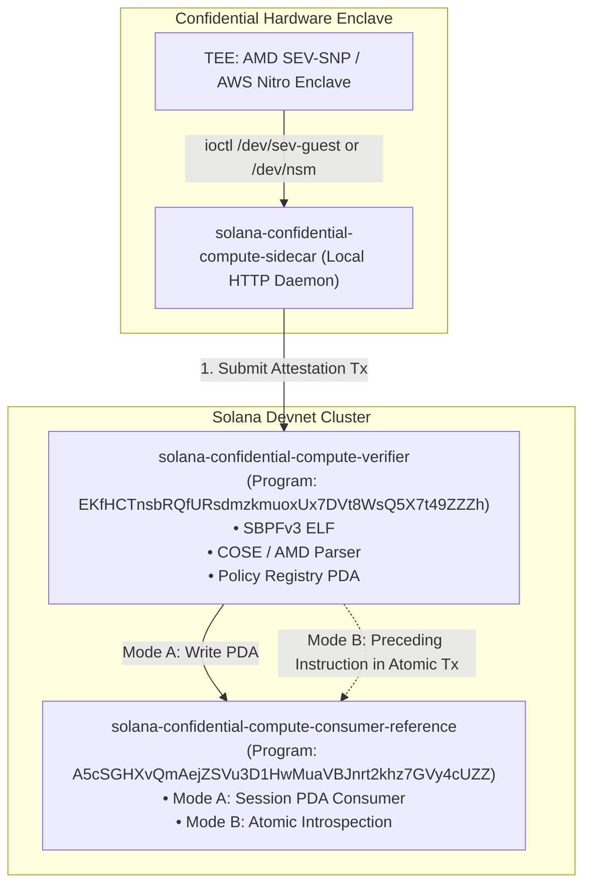

# Solana Confidential Compute — Milestone 4 Final Grant Closeout Dossier

> Historical V1 evidence: the 146-byte attested-signer layout and measurements in this report describe the grant closeout deployment, not the current integration contract. Current V2 uses `attested_signer_v2`, 154 bytes, and slot plus Unix expiry; see [the V2 account contract](../../crates/solana-confidential-compute-cpi/README.md#2-mode-a-account). Historical CU results do not prove V2 runtime performance.


Solana Foundation Grant Closeout Dossier — Milestone 4 Complete Deliverables.

- **Target Repository:** [solana-foundation/confidential-compute](https://github.com/solana-foundation/confidential-compute)
- **Documentation Portal:** Local Astro Starlight site ([`docs-site/README.md`](../../docs-site/README.md))
- **Release Version:** none. Pre-release software, crate version `0.1.0`.
- **Closeout anchor:** `@spec GRANT-M4-001`. This dossier is the grant closeout narrative. The root [README.md](../../README.md) is the repository documentation.
- **Solana Runtime Target:** SBPFv3 (SIMD-0171 / SIMD-0177 / SIMD-0500)
- **Status:** **DELIVERED & VERIFIED ON HARDWARE**

---

## 1. Executive Summary

Solana Confidential Compute verifies hardware attestation reports on Solana.

The system parses and validates genuine hardware attestation reports directly inside the Solana Virtual Machine (SVM). Verified hardware platforms in the grant closeout deployment are Google Cloud confidential VMs (AMD SEV-SNP) and AWS Nitro Enclaves:

On-chain signature verification routes through a fail-closed introspection backend with actual SBF compute/stack feasibility unverified in the current issue validation; see [SECURITY.md](../../SECURITY.md#8-auditor-scope--runtime-limitations) §8 for measured packet limits and research directions. Complete P-384 and RSA-4096 certificate hierarchies are verified offline against vendor root CAs in host tooling and hardware fixture suites (`solana-confidential-compute-crypto`, `solana-confidential-compute-cli`).

1. **Google Cloud confidential VMs (AMD SEV-SNP).**
2. **AWS Nitro Enclaves** (hardware-isolated microVMs via `/dev/nsm`).

Through native SBPFv3 optimization, zero-copy wire serialization, and dual execution modalities (Mode A Session PDA and Mode B Stateless Atomic Introspection), Solana Confidential Compute binds confidential off-chain compute to hardware attestation. Administrative control still depends on loader and registry authorities and their custody; see the [trust model](../../SECURITY.md#administrative-authorities-and-trust-roots).

---

## 2. Two-Program Architecture

Solana Confidential Compute separates hardware cryptographic verification from protocol business logic across two modular on-chain programs:



### 2.1 `solana-confidential-compute-verifier`

> Historical closeout description: the measurement-policy claim below records the earlier architecture. Current admission uses source-specific `BackendPolicy` (AMD=1, Nitro=2, GCP=3), while `PolicyRegistry` retains authority and AMD TCB floors; its global measurement fields are compatibility storage. See the [current governance contract](../intent/confidential-compute-verifier-specs.md#backend-measurement-governance). This historical claim does not establish current deployment state.

- **Program ID:** [`EKfHCTnsbRQfURsdmzkmuoxUx7DVt8WsQ5X7t49ZZZh`](https://explorer.solana.com/address/EKfHCTnsbRQfURsdmzkmuoxUx7DVt8WsQ5X7t49ZZZh?cluster=devnet)
- **Role:** Pure cryptographic verification engine. Parses binary attestation reports (AMD SEV-SNP 1,184-byte structs, AWS Nitro COSE Sign1 documents), validates hardware certificate hierarchies, checks measurement hashes against the on-chain `PolicyRegistry`, and establishes verifiable authenticity.

### 2.2 `solana-confidential-compute-consumer-reference`

- **Program ID:** [`A5cSGHXvQmAejZSVu3D1HwMuaVBJnrt2khz7GVy4cUZZ`](https://explorer.solana.com/address/A5cSGHXvQmAejZSVu3D1HwMuaVBJnrt2khz7GVy4cUZZ?cluster=devnet)
- **Role:** Reference implementation for third-party DeFi, oracle, and infrastructure protocols demonstrating how to consume Solana Confidential Compute attestations with minimal compute unit consumption.

---

## 3. Dual Modality Comparison & Use Cases

Solana Confidential Compute enables protocols to choose the optimal trade-off between transaction frequency, storage rent, and compute overhead:

| Dimension                | Mode A: Session Signer PDA                                                                                                                                       | Mode B: Zero-Storage Atomic Introspection                                                                                                              |
| :----------------------- | :--------------------------------------------------------------------------------------------------------------------------------------------------------------- | :----------------------------------------------------------------------------------------------------------------------------------------------------- |
| **Mechanism**            | Workload registers ephemeral Ed25519 keypair in 146-byte PDA                                                                                                     | Transaction combines Verifier Ix + Consumer Ix atomically                                                                                              |
| **State Footprint**      | 146 bytes rent-exempt PDA (`AttestedSignerAccount`)                                                                                                              | 49 bytes (`UsedNonceAccount`; rent refundable via `close_stale_nonce` after 150 slots; legacy 17-byte records are permanent)                         |
| **Consumer CUs**         | 355 compute units on Devnet (`@spec SCC-CONSUMER-001`)                                                                                                         | about 1,950 compute units (`@spec SCC-CONSUMER-002`)                                                                                                 |
| **Verifier Invocations** | Once per session / epoch (e.g. hourly or daily)                                                                                                                  | Every transaction                                                                                                                                      |
| **Optimal Use Cases**    | • High-frequency DeFi price oracles<br/>• Automated market maker quoting<br/>• Perpetual liquidity rebalancing<br/>• High-throughput private order-flow batching | • High-value treasury settlement<br/>• Cross-chain bridge governance updates<br/>• Infrequent protocol upgrades<br/>• Zero-state single-shot execution |

---

## 4. Live On-Chain Deployments & Verified Addresses

The grant closeout deployment is on Solana Devnet. The verifier ELF is SBPFv3 (`e_flags = 0x3`). The consumer ELF is `e_machine = 0x107`, `e_flags = 0x0`.

| Component                      | Network | Address / PDA                                                                                                                                     | ELF                                                     | Deployment Slot |
| :----------------------------- | :------ | :------------------------------------------------------------------------------------------------------------------------------------------------ | :------------------------------------------------------ | --------------: |
| **`solana-confidential-compute-verifier`**           | Devnet  | [`EKfHCTnsbRQfURsdmzkmuoxUx7DVt8WsQ5X7t49ZZZh`](https://explorer.solana.com/address/EKfHCTnsbRQfURsdmzkmuoxUx7DVt8WsQ5X7t49ZZZh?cluster=devnet)   | SBPFv3, `e_flags = 0x3`, 673,784 bytes                  |     505,980,419 |
| **`solana-confidential-compute-consumer-reference`** | Devnet  | [`A5cSGHXvQmAejZSVu3D1HwMuaVBJnrt2khz7GVy4cUZZ`](https://explorer.solana.com/address/A5cSGHXvQmAejZSVu3D1HwMuaVBJnrt2khz7GVy4cUZZ?cluster=devnet) | `e_machine = 0x107`, `e_flags = 0x0`, 127,744 bytes     |     505,980,264 |
| **`PolicyRegistry` PDA**       | Devnet  | [`2FX8HZqEXr7x8kHzkhy4KPUuViVt9M6xqhFTB12jaDUf`](https://explorer.solana.com/address/2FX8HZqEXr7x8kHzkhy4KPUuViVt9M6xqhFTB12jaDUf?cluster=devnet) | Initialized. Seed `[b"policy_registry"]`.               |               — |
| **Upgrade Authority**          | Devnet  | [`BNiGJpc6zkmkk7Jir1ggRfyxFy2fwjMmt2BUDUEg4eCG`](https://explorer.solana.com/address/BNiGJpc6zkmkk7Jir1ggRfyxFy2fwjMmt2BUDUEg4eCG?cluster=devnet) | BPF loader upgrade authority for both programs.        |               — |

---

## 5. Hardware Attestation Telemetry & Verification Proofs

### 5.1 Track A: Google Cloud Platform (AMD SEV-SNP)

- **Node:** `teton-sev-snp-node` (`n2d-standard-4`, AMD Milan, `us-central1-c`)
- **Kernel:** `GNU/Linux 7.0.0-1011-gcp x86_64` (Ubuntu 24.04.5 LTS), VMPL0 active, `/dev/sev-guest` verified.
- **Hardware Report:** 1,184-byte report fetched via `SNP_GET_REPORT` (`0xC0205300`).
- **Cryptographic Verification:** P-384 ECDSA signature verified against genuine AMD KDS VCEK leaf certificate.
- **Finding HW-01 Implemented:** Sliced 32-byte PSP response prefix (`rc=0, size=1184, reserved=[0; 24]`).
- **PR Reference:** **upstream PR #86** (`164ff65`, Closes **upstream issue #85**).
- **Hardware Evidence:** [`docs/verification/hardware-verification-gcp-sev-snp.md`](../verification/hardware-verification-gcp-sev-snp.md).
- **Committed Fixtures:** `fixtures/snp_hardware_report_milan.bin`, `fixtures/vcek_milan.der`.

### 5.2 Track B: Amazon Web Services (AWS Nitro Enclaves)
- **Node:** `teton-nitro-node` (`c6i.xlarge`, Intel Ice Lake, 4 vCPUs)
- **Enclave:** `nitro-probe` (`i-0c801b445eeba3a9e-enc01a0daae7e35adef`, CID 20, 2 vCPUs, 1024 MiB RAM, production mode).
- **Measurements:**
  - `PCR0` (EIF Image): `2a86e61029832fc64b047e727b2f2265eb07215d073cd458bf6debf5e557a43a146916546030cf5dd8398175f8441e66`
  - `PCR1` (Kernel/Bootstrap): `4b4d5b3661b3efc12920900c80e126e4ce783c522de6c02a2a5bf7af3a2b9327b86776f188e4be1c1c404a129dbda493`
  - `PCR2` (App Binary): `cfc7e55365dafbfe29eb90750a83ae38a4ed727402d194f52af6c5714e9afc54714faa9f0989c95fe075b3585b3eefb3`
- **Hardware Document:** 4,552-byte NSM response via `/dev/nsm` (`0xC0200A00`), streamed over vsock (CID 3, port 5005).
- **Cryptographic Verification:** Validated 4-cert X.509 chain against AWS Nitro Root CA G1 and verified P-384 ECDSA signature over `COSE_Sign1`.
- **Finding HW-02 Implemented:**
  - Supported indefinite-length CBOR maps (`0xbf...0xff`) emitted by the live Nitro hypervisor.
  - Handled major type 7 simple values (`public_key: null` / `0xf6`).
  - Raised `MAX_NITRO_DOCUMENT_LEN` to 8,192 bytes for full 4-certificate AWS PKI chains.
- **PR Reference:** **upstream PR #87** (`d9b3173`, Closes **upstream issue #71**).
- **Hardware Evidence:** [`docs/verification/hardware-verification-aws-nitro.md`](../verification/hardware-verification-aws-nitro.md).
- **Committed Fixtures:** `fixtures/nitro_hardware_attestation.bin`, `fixtures/nitro_hardware_document.cose`.

### 5.3 Live Solana Devnet Smoke Test

- **Signature:** [`2iEc1eAmyfu2QzgGjSuSEbCs28egC2z8rn9WLgcjbAZZ1mqmFbdNDhWoXHHZQSwkWHvS4W9ZZRURctnEkEQgbuuH`](https://explorer.solana.com/tx/2iEc1eAmyfu2QzgGjSuSEbCs28egC2z8rn9WLgcjbAZZ1mqmFbdNDhWoXHHZQSwkWHvS4W9ZZRURctnEkEQgbuuH?cluster=devnet)
- **Instruction:** `verify_nitro_attestation`, Mode A (`mode = 0`).
- **Document:** 522-byte synthetic COSE Sign1. The certificates are placeholders.
- **Compute Units:** The Devnet parsing path consumed 8,122 compute units.
- **Result:** The transaction tests fail-closed rejection. The program returned `Custom(2)` (`VerifierError::VerificationFailed`). It did not register a signer.
- **Other measured samples:** The Mode A consumer check consumed 355 compute units on Devnet (`@spec SCC-CONSUMER-001`). The Mode B consumer check consumed about 1,950 compute units under `solana-program-test` (`@spec SCC-CONSUMER-002`). Policy init consumed 7,435 compute units on Devnet. `@spec SCC-PERF-001`.

An oversized Nitro document still fails in the client before RPC submission (`PacketTooLargeError`, including the recorded `8614 > 1232` case). That local reject is separate from the on-chain transaction above.

---

## 6. Pre-Handoff Security & Quality Audit

The codebase underwent a 3-track Cloudflare-style defensive security audit (**upstream issue #62**):

- **Track 1 (Verifier & Crypto Engine):** Zero-copy parsing bounds, stack consumption under 4KB SBF limit, fail-closed certificate verification.
- **Track 2 (Consumer Reference & Wire):** Account substitution attack prevention, discriminator validation, `hash_action` integrity.
- **Track 3 (Enclave Runtime & Hardware Drivers):** Linux `/dev/sev-guest` and `/dev/nsm` ioctl safety, zeroize-on-drop secret key memory hygiene, local loopback ACL binding.

Workspace tests: 279 passed, 0 failed, 1 ignored (`test_cu_benchmarks_live_sbf`). TypeScript SDK tests: 17 passed (7 in `test/packet.test.cjs`, 10 in `test/nitro.test.cjs`). Clippy reports zero warnings under `-D warnings`.

```bash
cargo test --workspace
cargo clippy --workspace --all-targets -- -D warnings
cd sdks/typescript && npm test
```

---

## 7. Buyer Deployment and Operations

The Solana Foundation deploys and manages its own programs. The addresses in section 4 are the grantee Devnet deployment. A buyer deployment receives a new program id, a new upgrade authority, and a new `PolicyRegistry` PDA.

### 7.1 Build the SBPFv3 verifier

`scripts/build-sbpfv3.sh` compiles `programs/solana-confidential-compute-verifier` only. The script rejects an ELF whose `e_flags` is not `0x3`.

```bash
git clone https://github.com/solana-foundation/confidential-compute.git
cd confidential-compute
bash scripts/build-sbpfv3.sh
bash scripts/build-sbpfv3.sh --verify
```

The artifact is `target/deploy/solana_confidential_compute_verifier.so`. The Devnet copy of that program in the grant closeout deployment is 673,784 bytes.

Build the reference consumer with the same architecture and the platform-tools pin from the script (`v1.56`):

```bash
cargo-build-sbf --arch v3 --tools-version v1.56 \
  --manifest-path programs/solana-confidential-compute-consumer-reference/Cargo.toml
```

The artifact is `target/deploy/solana_confidential_compute_consumer_reference.so`. The Devnet copy in the grant closeout deployment is 127,744 bytes, `e_machine = 0x107`, `e_flags = 0x0`. That header is not SBPFv3. A buyer redeployment compiles the consumer with `--arch v3`, as in the command above.

### 7.2 Deploy through governance or Squads

Point the Solana CLI at the target cluster. Sign with the governance key or with the key that Squads will replace.

```bash
solana program deploy target/deploy/solana_confidential_compute_verifier.so
solana program deploy target/deploy/solana_confidential_compute_consumer_reference.so
```

Record both program ids. They match the section 4 ids only when the deploy uses those keypairs and the signer holds the upgrade authority `BNiGJpc6zkmkk7Jir1ggRfyxFy2fwjMmt2BUDUEg4eCG`.

### 7.3 Initialize the PolicyRegistry

`init_policy_registry` creates the singleton PDA. The seed is `[b"policy_registry"]`. Discriminator: `[90, 53, 0, 89, 164, 70, 107, 186]`.

The Devnet PDA `2FX8HZqEXr7x8kHzkhy4KPUuViVt9M6xqhFTB12jaDUf` belongs to program `EKfHCTnsbRQfURsdmzkmuoxUx7DVt8WsQ5X7t49ZZZh`. A new program id derives a new PDA.

Accounts, in order:

1. Authority. Signer and writable. The program stores this pubkey as the registry authority.
2. `PolicyRegistry` PDA. Writable.
3. System program.
4. Canonical upgradeable ProgramData account, owned by the loader. Required by upstream PR #219; its current upgrade authority must sign initialization. Initialize before program finalization.

`args.authority` must equal the signer. The program rejects an all-zero authority. A second initialization returns `AccountAlreadyInitialized`.

`scripts/smoke_test_devnet.ts` sends this instruction when the PDA for its configured program id is empty. It sets the authority to the payer.

This procedure requires the coordinated initialization and handoff fixes, upstream PR #219 and upstream PR #229, in the target program; it does not establish that they are merged or deployed. The baseline allowed optional ProgramData and had no registry transfer instruction. Existing captured registries are not recovered by these fixes.

`update_policy` requires the stored registry authority to sign. `rotate_root_cert` also checks that signature but then returns `InvalidInstruction` without writing (upstream PR #255). For a registry initialized under the deployer/payer, transfer registry custody separately with `rotate_authority`: `[current authority signer, registry writable, receiving authority signer]`, no payload. Both authorities sign in one transaction; the receiving governance program supplies its vault PDA signature through CPI. There is no pending-state change and no recovery after losing the current key. To initialize directly under a vault PDA instead, the vault must already be the loader upgrade authority and sign initialization through CPI. Merely supplying its address is insufficient. See the [trust model](../../SECURITY.md#administrative-authorities-and-trust-roots).

### 7.4 Hand the upgrade authority to Squads

The deploy signer remains the BPF upgrade authority until the transfer below.

Transfer loader authority after initialization and the separate registry handoff. Initialization requires the then-current loader authority to sign; verify both resulting authorities independently.

```bash
solana program set-upgrade-authority <PROGRAM_ID> \
  --new-upgrade-authority <SQUADS_VAULT_PUBKEY> \
  --skip-new-upgrade-authority-signer-check
```

**This command transfers loader upgrade authority only.** It leaves `PolicyRegistry.authority` unchanged. A loader transfer alone leaves a registry initialized under the deployer or smoke payer under that signer. Verify the two authority addresses and their governance configuration separately before declaring the handoff complete; use the separate consenting `rotate_authority` handoff when the current key is available. Neither this loader command nor the initialization fix recovers a lost authority or a previously captured registry.

Repeat the command for the consumer program id. `--skip-new-upgrade-authority-signer-check` lets a Squads vault receive authority without co-signing the transfer.

The grantee Devnet upgrade authority stays `BNiGJpc6zkmkk7Jir1ggRfyxFy2fwjMmt2BUDUEg4eCG` until that key signs a transfer. The same steps apply on mainnet. Change `--url` before you deploy.

---

## 8. Milestone Deliverable Sign-Off Matrix

| Deliverable Requirement         | Target Specification               | Validation Status | Evidence                                                                                               |
| :------------------------------ | :--------------------------------- | :---------------- | :----------------------------------------------------------------------------------------------------- |
| **SBPFv3 Native Compilation**   | `@spec SCC-DEPLOY-001`           | **COMPLETED**     | `e_flags = 0x3` binary deployed on Devnet                                                              |
| **Dual Modality Support**       | `@spec SCC-CONSUMER-001` / `002` | **COMPLETED**     | Mode A consumer check: 355 CUs on Devnet. Mode B consumer check: about 1,950 CUs.                     |
| **Two-Program Architecture**    | `@spec SCC-VERIFY-001` / `013`   | **COMPLETED**     | `solana-confidential-compute-verifier` & `solana-confidential-compute-consumer-reference` live on Devnet                                           |
| **AMD SEV-SNP Hardware Probe**  | `@spec SCC-CORE-001`             | **COMPLETED**     | Validated on GCP AMD Milan; closed in **upstream PR #86**    |
| **AWS Nitro Enclaves Probe**    | `@spec SCC-NITRO-001`..`006`     | **COMPLETED**     | Validated on AWS EC2 Ice Lake via sidecar; closed in **upstream PR #87** |
| **Live Devnet Verification**    | `@spec SCC-PERF-001`             | **COMPLETED**     | Tx `2iEc1e…buuH`: 8,122 CUs on the Devnet parsing path. `Custom(2)` on a 522-byte synthetic COSE document. |
| **Comprehensive Documentation** | Documentation Portal & Guides      | **COMPLETED**     | Local Astro Starlight portal (`docs-site/`) & root [`README.md`](../../README.md)                      |
| **Defensive Security Review**   | Cloudflare 6-Phase Framework       | **COMPLETED**     | Formal invariant specifications and verification suite in [`SECURITY.md`](../../SECURITY.md)            |
| **Hardware Driver Runbooks**    | AMD SEV-SNP & AWS Nitro Enclaves   | **COMPLETED**     | [`docs/hardware-testing-runbook.md`](../hardware-testing-runbook.md)                                   |
| **Cloud Teardown & Zero Waste** | Budget Protection Invariant        | **COMPLETED**     | GCP VM & project deleted; AWS EC2 instance terminated                                                  |
